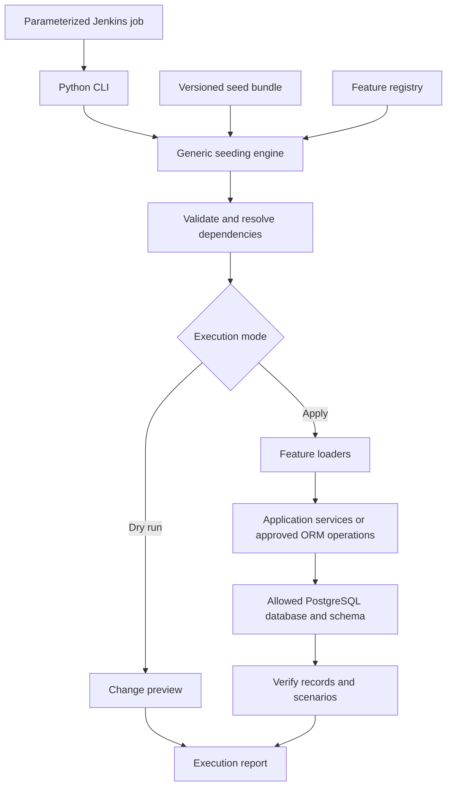

# NMDB Test Data Seeding — Generation and Insertion Design

|Item               |Details                                                                       |
|-------------------|------------------------------------------------------------------------------|
|Design task        |NEWSC-647 — NMDB Design: Generation/insertion                                 |
|Related task       |NEWSC-557 — Test data seeding for NMDB, staging environment for SI&T          |
|Document status    |Proposed design for team review                                               |
|Target environments|Development, SI&T staging and feature/branch test environments                |
|Application context|Python FastAPI, SQLAlchemy ORM and PostgreSQL, as provided in the task context|

The Jira requirements and feature coverage below are confirmed from the supplied screenshots\. The repository has not been reviewed\. Model names, enum values, natural keys, service methods and exact dependency order require verification before implementation\.

## 1\. Overview and Objectives

Provide a reusable mechanism to load representative sample data for the eight NMDB feature groups through one command or Jenkins job\. Testers should be able to prepare repeatable scenarios without manually uploading multiple files to separate endpoints\.

The recommended design combines a generic seeding engine, an explicit feature registry, feature\-specific loaders and version\-controlled seed bundles\. Existing SQLAlchemy models describe database structure; application validation and service logic define valid business scenarios\.

This page is the design deliverable for NEWSC\-647\. Implementation and the final repository mapping follow team agreement\.

## 2\. Scope and Scenario Coverage

|Feature              |Required sample scenarios                                                                             |Verification outcome                                                   |
|---------------------|------------------------------------------------------------------------------------------------------|-----------------------------------------------------------------------|
|NRD                  |Representative NRD data, including import logs                                                        |Imported records and corresponding logs can be inspected               |
|Update Nominations   |All supported states, locks, multiple users and dirty proposals                                       |State, ownership and locking scenarios can be exercised                |
|Sensor Status        |Sensors linked to platforms, all supported statuses and platforms with multiple sensors               |Correct platform associations and status coverage                      |
|Mission Management   |All supported mission states and threat export scenarios                                              |Exported threat data validates against the applicable XSD              |
|Intercept Correlation|Available emitters/platforms, initial administration configuration and Bruno matching request examples|Selection data and configuration support the example requests          |
|EW Tracks            |10 tracks with approximately 10 points each; mixed track-emitter and point-sensor values              |Track and point counts, references and value variation match the bundle|
|Activity Reports     |10 reports, a selection of associated EW tracks, and most reports linked to missions                  |Report counts and track/mission associations match the agreed scenarios|
|NEC                  |Different synchronization states and synchronization logs                                             |Seeded states and logs are consistent and inspectable                  |

Shared reference entities may be loaded as prerequisites\. This does not expand scenario coverage to every NMDB feature\.

Out of scope: production seeding, schema migrations within the seeder, performance\-scale data generation, redesigning existing APIs, and live synchronization with external systems\.

## 3\. Requirements

|ID    |Requirement                                                                                     |
|------|------------------------------------------------------------------------------------------------|
|FR-01 |Accept one versioned bundle containing the selected feature datasets and scenarios              |
|FR-02 |Execute through a single CLI entry point, optionally triggered by Jenkins                       |
|FR-03 |Support loading all scoped features or a selected subset with required prerequisites            |
|FR-04 |Resolve dependency order and logical references before database insertion                       |
|FR-05 |Validate structure, values, business rules and scenario coverage                                |
|FR-06 |Provide a dry run reporting the target, dependencies, counts and planned changes without writes |
|FR-07 |Support repeatable execution without duplicate seed records or unrelated data changes           |
|FR-08 |Report inserted, updated, skipped and failed records, plus verification results                 |
|FR-09 |Support cleanup restricted to records owned by the selected seed dataset                        |
|NFR-01|Block production and restrict execution to configured database/schema targets                   |
|NFR-02|Keep credentials outside bundles and mask sensitive values in logs                              |
|NFR-03|Prevent concurrent seed/cleanup operations against the same database and schema                 |
|NFR-04|Allow new loaders to be registered without changing the generic engine                          |
|NFR-05|Record bundle version/checksum, application revision, target and run identifier for traceability|

## 4\. Design Options

|Option                                |Strengths                                                   |Limitations                                                        |Decision                                     |
|--------------------------------------|------------------------------------------------------------|-------------------------------------------------------------------|---------------------------------------------|
|Separate scripts per feature          |Simple initial implementation; explicit feature logic       |Repeated dependency, transaction and reporting code                |Use feature loaders within a shared framework|
|Fully generic ORM-driven generator    |Reuses column types and database metadata                   |Cannot infer realistic workflows, locks or valid business scenarios|Use introspection as supporting validation   |
|JSON bundles with feature loaders     |Reviewable, repeatable scenarios with explicit relationships|Requires bundle ownership and maintained adapters                  |Recommended data and loading approach        |
|Single administrative API             |Convenient centralized invocation                           |Adds runtime access control and operational maintenance            |Defer unless a UI/API requirement arises     |
|CLI with Jenkins integration          |One execution entry point; fits deployment/test workflows   |Requires execution packaging and credentials                       |Recommended execution approach               |
|SQL scripts or Alembic data migrations|Useful for limited static reference data                    |Poor fit for selectable scenarios and service workflows            |Keep test datasets outside schema migrations |

These options cover different layers\. JSON defines the input, loaders implement feature behavior, and CLI/Jenkins provides execution\.

## 5\. Recommended Architecture



|Component       |Responsibility                                                                                                               |
|----------------|-----------------------------------------------------------------------------------------------------------------------------|
|Generic engine  |Bundle parsing, planning, dependency ordering, reference resolution, transaction coordination, ownership checks and reporting|
|Feature registry|Explicit allowlist of supported loaders, their models, schemas and prerequisites                                             |
|Feature loader  |Input mapping, scenario generation, business validation, insertion mechanism and feature verification                        |
|Seed bundle     |Curated datasets, logical references, scenario names, counts and version information                                         |
|CLI             |Select target, bundle, features and execution mode                                                                           |
|Jenkins job     |Supply controlled parameters and credentials, run the CLI and archive results                                                |

Workflow\-sensitive data must use approved application service paths where required\. Direct ORM operations are appropriate only after confirming they preserve necessary rules and do not bypass required audit or state behavior\.

## 6\. Dynamic Feature Loading

The engine loads registered feature adapters, rather than indiscriminately scanning and seeding every models\.py file\.

Each adapter declares:

- Feature identifier and associated ORM model classes\.
- Input validation schema and any seed\-specific reference fields\.
- Feature and shared\-reference prerequisites\.
- Stable matching keys and seed ownership rules\.
- Logical reference mappings to database identifiers\.
- Supported scenario templates and deterministic generation rules\.
- Approved insertion/update mechanism and verification checks\.

After model imports, SQLAlchemy metadata can identify required columns, types, foreign keys and unique constraints\. Whether NMDB uses a shared Base\.metadata or multiple registries must be checked in the repository\. Metadata supports structural checks; adapters supply business dependencies and scenario semantics\.

To add a feature: create its loader and dataset, declare its prerequisites and keys, register it, and add scenario verification\. The engine remains unchanged when the feature fits the adapter contract\.

## 7\. Dependencies and Repository Verification

The following are scenario prerequisites, not a verified foreign\-key map\.

|Feature              |Prerequisites to check                                    |Repository details to establish                                  |
|---------------------|----------------------------------------------------------|-----------------------------------------------------------------|
|NRD                  |Required reference entities and supported import mechanism|XML contract, import service, record keys and log creation       |
|Update Nominations   |Target records and representative users                   |State transitions, lock ownership and dirty proposal rules       |
|Sensor Status        |Platforms and sensors                                     |Platform/sensor links, status enum and uniqueness                |
|Mission Management   |Entities needed for each mission and export scenario      |Mission states, relationship constraints and exporter/XSD version|
|Intercept Correlation|Emitters, platforms and initial configuration             |Selection rules, configuration dependencies and request schema   |
|EW Tracks            |Emitters and sensors used by tracks/points                |Track/point relations, timestamp and value constraints           |
|Activity Reports     |Selected EW tracks and missions                           |Report associations and allowed combinations                     |
|NEC                  |Records participating in simulated synchronization        |State definitions, logs and external side effects                |

The engine builds a graph from declared prerequisites and verified model relationships, then orders insertion using a topological sort\. Missing prerequisites and unsupported cycles fail planning before writes\. A selected feature either includes its required prerequisites or resolves them unambiguously from existing allowed reference data\.

Natural keys must be checked against real uniqueness guarantees\. Where no suitable key exists, use a persistent seed ownership mapping with uniqueness on bundle identity, feature and logical record key\. Seed references are portable logical identifiers; database\-generated IDs are resolved at runtime\.

## 8\. Input Format and Data Generation

Use a version\-controlled bundle containing a manifest, one JSON dataset per selected feature, optional scenario definitions, and any required existing\-format fixtures\.

JSON is recommended as the orchestration format\. Retain NRD XML when exercising the actual NRD import behavior: the NRD loader should invoke the existing import service with a valid XML fixture and verify resulting records and logs\. JSON does not replace the domain XML contract\.

Illustrative manifest — proposed seeder format, not an existing NMDB API schema:

```json
{
  "bundle_id": "sit-demo-baseline",
  "bundle_version": "1.0",
  "random_seed": 647,
  "features": {
    "ew_tracks": {
      "file": "ew_tracks.json",
      "scenario": "mixed_references",
      "track_count": 10,
      "points_per_track": 10
    },
    "activity_reports": {
      "file": "activity_reports.json",
      "report_count": 10
    }
  }
}
```

A logical reference such as a track named `track-01` can be used by an activity report\. The loader resolves it to the inserted or verified existing track ID\. These symbolic keys belong to the seeding format and need not be application model fields\.

Use curated scenarios for workflow states, locks, users, exports and synchronization\. Generate repetitive track points or other simple values deterministically within feature constraints\. Fix scenario time anchors as well as the random seed so repeated generation remains reproducible\. Arbitrary values derived only from column types are insufficient for valid business data\.

## 9\. Execution Flow

1. Select an allowlisted environment, database/schema, bundle and feature set\.
2. Verify the target identity, application/bundle compatibility and required migrations\. The seeder does not create or migrate application tables\.
3. Load registered adapters; validate bundle structure, enums, prerequisites and logical references\.
4. Resolve dependency order and generate deterministic scenario data\.
5. Compare planned records with existing records and ownership mappings\.
6. Produce a dry\-run report showing additions, permitted updates, skips and conflicts\. No import, service or database writes occur during dry run\.
7. For apply mode, acquire the target lock and revalidate the plan against current data\.
8. Execute loaders in dependency order under the defined transaction policy\.
9. Verify database relationships, scenario counts and relevant application behavior, including threat export/XSD validation\.
10. Commit successful database changes and publish the execution report\. On failure, roll back the database transaction and record the failure separately\.

Dry run validates what can be established without writes\. Service\-only checks that require persisted data must be identified in the preview and performed during apply/verification\.

## 10\. Validation, Repeatability and Cleanup

|Area                 |Proposed behavior                                                                                                                        |
|---------------------|-----------------------------------------------------------------------------------------------------------------------------------------|
|Structural validation|Validate the seed envelope, then mapped fields using suitable existing Pydantic schemas and seed-specific rules                          |
|Business validation  |Apply required service rules and supported transitions; request schemas alone do not validate complete workflows                         |
|References           |Reject unresolved or ambiguous references; never guess foreign-key values                                                                |
|Repeat execution     |Reuse owned records using stable keys; unchanged records are skipped                                                                     |
|Existing unowned data|Reuse only explicitly allowed reference records; conflicts fail without overwriting unrelated records                                    |
|Workflow updates     |Let each loader define permitted behavior; do not reset state, locks or history through a generic upsert                                 |
|Transactions         |Prefer one database transaction per bundle, subject to service support; loaders must not commit independently                            |
|External effects     |Disable real external calls and background sync during seeding; database rollback cannot reverse messages or external imports            |
|Cleanup              |Explicit separate operation; remove only owned records in reverse dependency order and block removal where unowned records depend on them|
|Reports              |Capture target, bundle checksum/version, application revision, run ID, counts, failures and verification outcomes                        |

If existing services commit independently or produce unavoidable external effects, document the affected loader’s recovery boundary before implementation\. Atomic rollback must not be claimed for those operations\.

## 11\. Environment and Jenkins Integration

Provide a parameterized job with: target environment, approved schema, bundle version, feature selection, and action &#40;`validate`, `dry-run`, `apply`, or `cleanup`&#41;\. Credentials come from managed Jenkins credentials and environment configuration\.

Resolve the target through server\-side configuration rather than accepting an arbitrary database URL\. Check the resolved database/schema against a non\-production allowlist\. Use the existing branch/staging schema resolver after repository verification\. Do not infer the environment from a schema prefix alone\.

Migrations must complete before seeding\. Keep migrations and the seeding job coordinated so they cannot overlap on the same target\. Archive the execution report and fail the Jenkins job on validation, insertion or verification errors\.

Initial recommendation: manual parameterized execution, with dry run available by default\. Automatic seeding after staging deployment is a team decision once repeatability and scenario ownership are demonstrated\.

## 12\. Proposed Implementation Layout

|Area                |Proposed contents                                                             |
|--------------------|------------------------------------------------------------------------------|
|`seeding/cli`       |Command arguments and target selection                                        |
|`seeding/engine`    |Planning, reference resolution, ownership and transaction coordination        |
|`seeding/registry`  |Supported feature adapter registration                                        |
|`seeding/loaders`   |One adapter per scoped feature                                                |
|`seeding/bundles`   |Versioned manifests, JSON datasets and XML fixtures                           |
|`seeding/validation`|Shared input and scenario checks                                              |
|`seeding/reporting` |Preview and execution reports                                                 |
|Seeding tests       |Repeatability, rollback, target restrictions and feature scenario verification|

This layout is a proposal and must follow the repository’s established conventions\.

## 13\. Risks and Mitigations

|Risk                                            |Mitigation                                                                      |
|------------------------------------------------|--------------------------------------------------------------------------------|
|ORM inserts bypass business rules               |Approve the write path per feature and reuse required services                  |
|Model/schema changes invalidate bundles         |Version bundles and validate compatibility before writes                        |
|Incomplete dependencies cause partial data      |Preflight references and dependency order; reject unresolved cycles             |
|Repeated runs duplicate logs or state history   |Define stable scenario identity and repeat behavior in each loader              |
|Cleanup deletes shared records                  |Track ownership, inspect dependants and restrict cleanup to the selected dataset|
|Simulated NEC data triggers live synchronization|Suppress external integrations/background processing in the target environment  |

## 14\. Acceptance Criteria

Design completion:

- This page documents the input format, centralized insertion approach, alternatives and selected design\.
- The eight scoped feature groups and their required scenarios are represented\.
- A short team review records agreement and assigns owners to unresolved decisions\.
- Repository verification produces the actual model, dependency, matching\-key and service\-path mapping before implementation\.

Implementation acceptance:

- One CLI invocation or Jenkins job loads an agreed bundle without manual uploads to multiple endpoints\.
- A selected feature subset correctly handles its prerequisites\.
- EW Tracks contains 10 tracks with approximately 10 points each; Activity Reports contains 10 reports with the agreed associations\.
- Supported state coverage is checked against repository definitions; mission threat exports validate against the applicable XSD\.
- Intercept Correlation examples are provided in Bruno and execute against the seeded selection/configuration data\.
- Repeating an unchanged bundle creates no duplicate seed records, logs or workflow history\.
- Dry run performs no writes; an injected database failure rolls back the documented transaction boundary\.
- Production targets are rejected and unrelated data is preserved during apply and cleanup\.

## 15\. Team Review and Decisions

|Decision                   |Proposed position                                                     |Confirmation needed                                                                |
|---------------------------|----------------------------------------------------------------------|-----------------------------------------------------------------------------------|
|Input format               |JSON orchestration plus XML fixtures for NRD import scenarios         |Backend and SI&T agreement                                                         |
|Bundle ownership           |Feature developers maintain adapters; SI&T/QA review scenario coverage|Named maintainers and review process                                               |
|Matching and ownership keys|Verified natural keys or persistent seed mappings                     |Mapping for each feature                                                           |
|Workflow write paths       |Existing services where required; approved ORM operations elsewhere   |Model/service inspection                                                           |
|Execution trigger          |Manual CLI/Jenkins initially                                          |Whether staging deployment should seed automatically                               |
|Reference data and users   |Explicit reusable test prerequisites                                  |Allowed identities and shared record ownership                                     |
|Scenario details           |Valid states from code; agreed distribution and associations          |Meaning of dirty proposals, locks, NEC states and “most” reports linked to missions|
|Transaction policy         |Atomic bundle where service behavior permits                          |Import/service commit behavior and integration suppression                         |

Suggested 30\-minute review: confirm scope/input format &#40;5 minutes&#41;, architecture and dependencies &#40;10 minutes&#41;, execution/ownership/transactions &#40;10 minutes&#41;, and record decisions and follow\-up owners &#40;5 minutes&#41;\.

Recommended decision: adopt versioned seed bundles with a shared engine and registered feature loaders, invoked through a CLI and parameterized Jenkins job\. Complete the repository mapping before implementing the loaders\.
